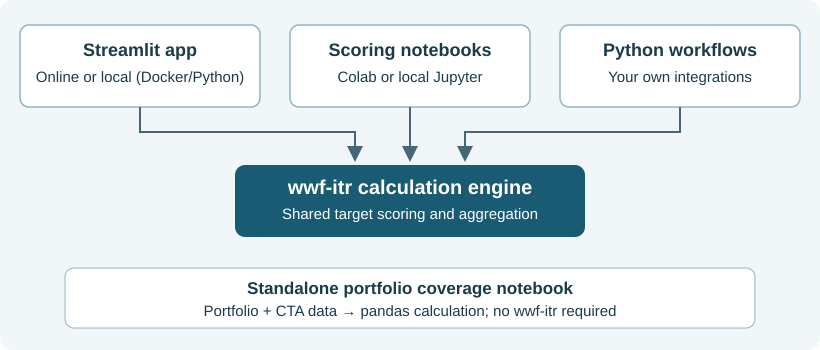

WWF ITR Tool: Temperature Scoring & Portfolio Coverage
======================================================

Understand what drives your portfolio's temperature score and use the
results to inform engagement and portfolio analysis. The WWF ITR Tool
implements the `CDP-WWF Temperature Scoring Methodology v1.5
<https://wwfint.awsassets.panda.org/downloads/cdp-wwf-temperature-scoring-methodology---september-2024.pdf>`_.
It calculates company and portfolio temperature scores from climate
targets, and portfolio coverage by SBTi-validated near-term targets.

Choose how to use the tool
--------------------------

.. list-table:: Start here
   :header-rows: 1
   :widths: 28 38 34

   * - Your goal
     - Start with
     - Where it runs
   * - Try the tool without installing anything
     - `Open the online app <https://wwf-itr.streamlit.app/>`_ with sample data; see :doc:`getting_started_app`.
     - Streamlit Community Cloud, in your browser.
   * - Analyze your own data in a graphical interface
     - :ref:`Run the app with Docker <app-docker>`.
     - On your own computer.
   * - Learn the method and adapt a worked analysis
     - :doc:`notebooks`: Google Colab or local Jupyter.
     - Google's infrastructure or your own computer.
   * - Integrate scoring into your own workflow
     - :doc:`getting_started`: install the ``wwf-itr`` Python package.
     - Your chosen Python environment.

Docker runs the same Streamlit app locally. You can also
:ref:`run Streamlit directly with Python <app-local-streamlit>`.
For confidential portfolios, choose a local app or notebook environment
rather than the public cloud demo or Colab.

One toolkit, shared calculations
--------------------------------

**WWF ITR Tool** is the toolkit as a whole. **wwf-itr**, developed in
`ITR-tool <https://github.com/WWF-Sweden/ITR-tool>`_, is the Python scoring
engine (imported as ``ITR``). **WWF-ITR-APP** provides the Streamlit
interface to that engine. The scoring notebooks use the engine too;
the simplified portfolio coverage notebook is a standalone pandas example.

Use :doc:`intro` for an explanation of the method and outputs,
:doc:`DataRequirements` to prepare files, and :doc:`Legends` for field
definitions. The tool accepts user-supplied company and portfolio data;
example files are demonstrations, not an investment data service.
The :doc:`autoapi/index` describes the Python interface.

Questions or problems? See :doc:`troubleshooting` and :doc:`links`.
Contributions to code, examples and documentation are welcome; see
:doc:`contributing`. Results describe target-based alignment assumptions
and do not guarantee future emissions or official target validation.

.. toctree::
   :maxdepth: 2
   :caption: Contents

   intro
   getting_started_app
   using_app
   notebooks
   getting_started
   FunctionalOverview
   DataRequirements
   Legends
   troubleshooting
   contributing
   links
   terms
